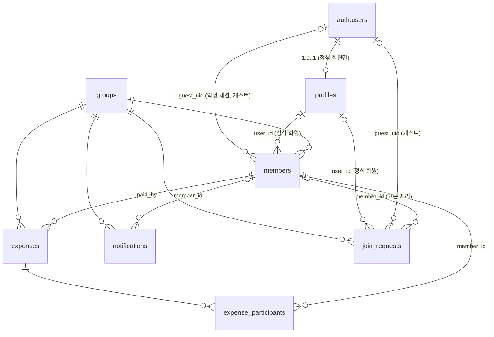

# 데이터 스키마

## 엔티티 목록

- User — 이메일로 가입한 정식 회원. 게스트 참가자는 User가 아니라 Member로만 존재함 ([conventions.md](conventions.md#정식-회원--게스트-참가자) 참고)
- Group — 정산 그룹(여행 단위)
- Member — 그룹에 속한 인원. 정식 회원(`userId` 있음)이거나, 게스트 또는 아직 앱에 가입하지 않은 "미가입 멤버"(`userId` 없이 이름만 있는 placeholder — 게스트와 데이터 구조가 동일함) 일 수 있음 ([12-group-invite.md](12-group-invite.md) 참고)
- Expense — 그룹 내 지출 1건
- ExpenseParticipant — 지출 1건에 대한 참여자 1명의 분담 정보
- Notification — 그룹 내 이벤트(지출 등록, 멤버 참여) 알림 1건
- JoinRequest — 초대코드로 들어온 사람의 참여 요청 1건. 방장이 승인해야 Member가 된다 ([06-join-group.md](06-join-group.md), [12-group-invite.md](12-group-invite.md))

## User

> ✅ 로그인 방식 확정 (2026-09-12, sep10 프로토타입 기준): **이메일+비밀번호만 지원, 구글·카카오 연동 로그인은 스펙에서 제외**. `googleId`/`kakaoId` 필드 삭제.
>
> ✅ 게스트 모델 확정 (2026-09-12): 게스트는 `User` row를 아예 만들지 않음 — PIN 등 별도 인증도 없음. 초대코드로 참여할 때 이름만 입력하면 `Member`(아래 참고)로만 존재함. 자세한 내용은 [06-join-group.md](06-join-group.md) 참고.

회원가입 2단계([02-onboarding.md](02-onboarding.md))를 마치는 시점에 생성됨(1단계 [01-login.md](01-login.md)에서는 만들지 않음). 게스트는 User를 만들지 않고 [06-join-group.md](06-join-group.md)의 초대코드 참여 시점에 Member만 생성됨.

| 필드 | 타입 | 설명 |
|---|---|---|
| id | string | 내부 식별자 (`uid('u')`로 생성) |
| authProvider | 'email' | 계정 종류. 항상 'email' (구글·카카오 연동은 스펙에서 제외, 2026-09-12). 게스트는 `User` row 자체가 없으므로 이 값이 필요 없음 |
| email | string | 회원 식별자(UNIQUE) |
| emailVerified | boolean | 이메일 인증 여부. 인증 필수화 여부는 미정([01-login.md](01-login.md) 참고) — 기본값 false |
| passwordHash | string | bcrypt 해시 |
| name | string | 이름. 회원가입 시 직접 입력, 온보딩/프로필에서 수정 가능 |
| bank | string | 은행명. [공통 은행 목록](conventions.md#은행-목록) 중 하나. 정식 회원은 가입 시 필수 입력 |
| account | string | 계좌번호. 형식 검증 없는 자유 텍스트 (현재 프로토타입 기준). 정식 회원은 가입 시 필수 입력 |
| seenGroupCreateCoach | boolean | 첫 그룹 생성 코치마크([03-group-list.md](03-group-list.md))를 이미 봤는지 여부. 1회성 안내 노출 제어용 |

> `email`은 회원가입 시 중복 체크로만 쓰이는 UNIQUE 식별자. 소셜 로그인 연동이 없어 계정 자동 매칭/탈취 위험 시나리오는 해당 없음.

## Group

그룹 목록([03-group-list.md](03-group-list.md))에서 조회, 새 그룹 만들기([05-create-group.md](05-create-group.md))에서 생성됨.

| 필드 | 타입 | 설명 |
|---|---|---|
| id | string | 내부 식별자 (`uid('g')`로 생성) |
| name | string | 그룹(여행) 이름 |
| inviteCode | string | 6자리 초대코드 ([06-join-group.md](06-join-group.md), [12-group-invite.md](12-group-invite.md)에서 사용) |
| members | Member[] | 그룹에 속한 인원 목록 |
| expenses | Expense[] | 그룹 내 지출 목록 |

> 그룹의 "총 지출", "멤버 수" 등은 별도 필드로 저장하지 않고 `members`/`expenses`를 매번 계산해서 표시함.

## Member

그룹과 참여자를 잇는 관계 엔티티(User와 별개). 정식 회원, 게스트, placeholder 멤버가 모두 이 엔티티로 표현됨.

| 필드 | 타입 | 설명 |
|---|---|---|
| id | string | 내부 식별자 (`uid('m')`로 생성). Expense.paidBy·ExpenseParticipant.memberId 등이 참조하는 안정적인 키 — `userId`는 placeholder/게스트일 때 null이라 FK로 못 씀 |
| userId | string \| null | 연결된 User.id. placeholder 멤버와 게스트는 `userId`가 없음(둘 다 계정 자체가 없음) — 정식 회원으로 참여할 때(예: 대기 중 자리를 초대코드로 차지할 때)만 채워짐 |
| groupId | string | 소속 Group.id |
| role | 'owner' \| 'member' | 그룹장 여부. 게스트와 placeholder는 항상 'member' (그룹장은 정식 회원만 가능) |
| name | string \| null | 표시 이름. `userId`가 null일 때(placeholder 또는 게스트) 사용, 정식 회원은 null(User.name 사용) |
| joinedAt | timestamp | 그룹 참여 시각 |

> ✅ 2026-09-12 확정: 게스트는 별도 `User` row나 PIN 없이, 이 `Member` 테이블에 `userId: null` + `name`만으로 표현됨 — placeholder 멤버와 데이터 구조가 완전히 동일함(초대에 응해서 "실제로 참여"했는지 여부만 다름). 재입장 시에도 그룹 멤버 목록에서 이름을 다시 고르면 그 Member로 인식되며 별도 인증 없음(스푸핑 방지 장치 없음 — 수용된 트레이드오프).
>
> **화면에 표시할 이름 결정 순서**(08~13 전반에서 공통으로 씀): `userId`가 null이면(placeholder 또는 게스트) → `Member.name`. `userId`가 있으면 정식 회원 → `User.name`.

## Expense

지출 등록/수정 폼([11-expense-form.md](11-expense-form.md))에서 생성·수정되고, 지출 목록([08-group-expense-list.md](08-group-expense-list.md))·정산([09-group-settle.md](09-group-settle.md))·요약([10-group-summary.md](10-group-summary.md))에서 조회됨.

| 필드 | 타입 | 설명 |
|---|---|---|
| id | string | 내부 식별자 (`uid('e')`로 생성) |
| groupId | string | 소속 Group.id |
| paidBy | string | 결제자의 Member.id(User.id 아님) — placeholder도 결제자로 지정될 수 있어서 항상 존재하는 Member.id를 참조 |
| title | string | 항목명 |
| amount | number | 지출 금액(원) |
| category | string | 카테고리 6종 중 하나 — [마스터 데이터](#마스터-데이터) 참고 |
| receiptImageUrl | string \| null | 영수증 사진(선택) |
| splitType | 'equal' \| 'ratio' \| 'amount' | 나누기 방식 |
| spentAt | date | 사용 날짜. 기본값 오늘 |
| createdAt | timestamp | 등록 일시 |

### ExpenseParticipant

| 필드 | 타입 | 설명 |
|---|---|---|
| expenseId | string | 소속 Expense.id |
| memberId | string | 참여자의 Member.id(User.id 아님) — placeholder도 참여자로 지정될 수 있어서 항상 존재하는 Member.id를 참조 |
| shareAmount | number \| null | 이 참여자의 분담액. `splitType`이 equal이면 null(매번 계산), ratio/amount면 등록 시점에 정수(원 단위)로 확정 저장 |

> `expenseId` + `memberId`가 합쳐서 PRIMARY KEY — 한 지출에 같은 사람이 두 번 참여자로 안 들어감.

## Notification

지출 등록, 신규 멤버 참여 이벤트를 그룹 내 사용자에게 알리는 항목. [13-notifications.md](13-notifications.md)에서 조회.

| 필드 | 타입 | 설명 |
|---|---|---|
| id | string | 내부 식별자 |
| groupId | string | 어느 그룹에서 발생한 알림인지 |
| memberId | string \| null | 이벤트를 일으킨 사람의 Member.id — 지출 등록 알림이면 결제자, 멤버 참여 알림이면 그 새 멤버 |
| type | 'expense' \| 'member_joined' \| 'expense_deleted' \| 'join_request' | 알림 종류 — [마스터 데이터](#마스터-데이터) 참고 |
| title | string | 화면에 보여줄 문구. 생성 시점에 이름을 채워 고정 저장(이후 이름이 바뀌어도 문구는 그대로) |
| createdAt | timestamp | 생성 일시(화면엔 상대 시간으로 표시) |
| read | boolean | 읽음 여부. 기본값 false |

## JoinRequest

초대코드로 참여하려는 사람의 요청. [06](06-join-group.md)/[07](07-join-match.md)에서 만들어지고, [12](12-group-invite.md)에서 방장이 승인하면 지워지며 그때 Member가 생기거나 기존 자리가 연결된다. **거절하면 `rejected` 상태로 남아** 요청한 사람에게 "거절됨"으로 보이고(방장에게는 안 보임), 다시 요청하면 `pending`으로 바뀐다(2026-10-17). 한 사람은 한 그룹에 요청 하나만 가진다(다시 요청하면 바뀜).

| 필드 | 타입 | 설명 |
|---|---|---|
| id | string | 내부 식별자 |
| groupId | string | 참여하려는 Group.id |
| requester | User.id 또는 게스트 세션 | 요청한 사람. 정식 회원이면 계정, 게스트면 그 브라우저의 익명 세션 |
| memberId | string \| null | "이게 나예요"로 고른 자리(아직 계정이 연결되지 않은 Member). 새 멤버로 참여하면 null |
| name | string | 방장에게 보여줄 이름. 요청 시점에 고정(회원: 프로필 이름, 게스트: 입력한 이름 또는 고른 자리의 이름) |
| status | 'pending' \| 'rejected' | 승인 대기 / 거절됨 (2026-10-17). 승인되면 요청은 지워진다 |
| createdAt | timestamp | 요청 시각 |

## 마스터 데이터

- **카테고리(6종)**: 숙소 / 식비 / 교통 / 액티비티 / 쇼핑 / 기타
- **splitType(3종)**: equal(균등) / ratio(비율) / amount(금액)
- **Notification.type(4종)**: expense(지출 등록) / member_joined(멤버 참여) / expense_deleted(지출 삭제) / join_request(참여 요청)
- **은행 목록**: [conventions.md](conventions.md#은행-목록) 참고

## 계산 로직

1. **잔액 계산**: 멤버별 `balance = 결제 합(paidBy 기준 amount 합) - 부담 합(참여자로 지정된 지출들의 shareAmount 합)`
2. **분담액(shareAmount) 계산**
   - `equal`: `base = floor(amount / N)`, 나머지는 참여자 전체를 memberId 오름차순으로 정렬해 앞에서부터 1원씩 추가
   - `ratio`: 입력한 %를 원 단위로 환산(내림) 후, 남는 오차를 참여자 memberId 오름차순으로 1원씩 분배
   - `amount`: 입력값을 그대로 저장
3. **최소 송금 매칭**: 채권자(balance>0)·채무자(balance<0)를 각각 금액 내림차순 정렬 후 가장 큰 채권자·채무자부터 그리디 매칭
4. **카테고리별 집계**: `Expense.category`로 그룹핑해서 합산

## 관계도

## DB 구현 (Supabase / PostgreSQL)

> 이 섹션은 실제 DB가 위 스펙을 어떻게 구현하는지의 **요약**이다. 컬럼·제약·정책의 원본은 SQL 파일이며, 둘이 다르면 SQL이 기준이다.
> - [`supabase/migrations/20260920000000_init_schema.sql`](../../supabase/migrations/20260920000000_init_schema.sql) — 테이블, RLS, 가입/탈퇴 트리거, 그룹 생성·참여 RPC
> - [`supabase/migrations/20260920000100_guest_support.sql`](../../supabase/migrations/20260920000100_guest_support.sql) — 게스트(익명 로그인) 지원. **위 파일을 먼저 실행한 뒤** 실행
> - [`supabase/migrations/20260921000000_delete_account.sql`](../../supabase/migrations/20260921000000_delete_account.sql) — 회원 탈퇴용 함수 `delete_my_account()`. 위 두 파일 다음에 실행
> - [`supabase/migrations/20260927000000_rename_guest_member.sql`](../../supabase/migrations/20260927000000_rename_guest_member.sql) — 게스트 본인 이름 수정용 함수 `rename_guest_member()`. 위 세 파일 다음에 실행
> - [`supabase/migrations/20261003000000_account_rpc_and_invite_rotation.sql`](../../supabase/migrations/20261003000000_account_rpc_and_invite_rotation.sql) — 계좌 조회 함수(`get_my_profile`, `get_payee_accounts`), 가입 때 계좌가 로그인 정보에 복사되던 것 정리, 초대코드 재발급(`rotate_invite_code`). **추가만 하는 안전한 단계**
> - [`supabase/migrations/20261005000000_expense_deleted_notification.sql`](../../supabase/migrations/20261005000000_expense_deleted_notification.sql) — 지출을 삭제하면 같은 그룹에 알림이 가도록 하는 트리거(`notify_expense_deleted`). **추가만 하는 안전한 단계**
> - [`supabase/migrations/20261003000100_restrict_profile_columns.sql`](../../supabase/migrations/20261003000100_restrict_profile_columns.sql) — `profiles`의 은행·계좌 컬럼을 API로 직접 못 읽게 막음. **바로 위 파일을 적용하고 앱이 새 버전으로 배포된 뒤에만 적용** (먼저 적용하면 옛 앱이 프로필을 못 읽음)
> - [`supabase/migrations/20261010000000_email_registered_check.sql`](../../supabase/migrations/20261010000000_email_registered_check.sql) — 회원가입 1단계 이메일 중복 확인 함수(`is_email_registered`). **추가만 하는 안전한 단계** (앱은 함수가 없으면 확인을 건너뜀)
> - [`supabase/migrations/20261011000000_profile_after_confirmation.sql`](../../supabase/migrations/20261011000000_profile_after_confirmation.sql) — 가입 순서 변경("이메일 확인 → 이름·계좌 등록")용: 가입 트리거가 이름·계좌가 있을 때만 프로필을 만들고, 로그인한 본인이 프로필을 만드는 `complete_profile()` 추가. **추가만 하는 안전한 단계 — 새 앱을 배포하기 전에 먼저 적용**
> - [`supabase/migrations/20261011000100_join_approval.sql`](../../supabase/migrations/20261011000100_join_approval.sql) — 초대코드 참여에 **방장 승인** 추가: `join_requests` 테이블, `request_join()`·`list_join_requests()`·`approve_join_request()`·`reject_join_request()`·`cancel_join_request()`, 알림 종류 `join_request`. **추가만 하는 안전한 단계 — 새 앱을 배포하기 전에 먼저 적용** (앱은 요청 목록을 못 불러오면 빈 목록으로 넘김)
> - [`supabase/migrations/20261011000200_lock_direct_join.sql`](../../supabase/migrations/20261011000200_lock_direct_join.sql) — 승인 없이 바로 멤버가 되던 `join_group()`을 클라이언트가 못 부르게 막음. **바로 위 파일을 적용하고 앱이 새 버전으로 배포된 뒤에만 적용** (그 전까지는 API로 `join_group()`을 직접 불러 승인을 건너뛸 수 있음)
> - [`supabase/migrations/20261012000000_name_length_limit.sql`](../../supabase/migrations/20261012000000_name_length_limit.sql) — 이름(프로필·멤버·참여 요청) 길이를 20자로 제한하는 CHECK 제약. 이미 저장된 행은 검사하지 않는다(NOT VALID). **추가만 하는 안전한 단계**
> - [`supabase/migrations/20261017000000_join_request_status.sql`](../../supabase/migrations/20261017000000_join_request_status.sql) — 참여 요청에 `status`(대기/거절) 추가, 거절해도 지우지 않음. **새 앱 배포 뒤에 적용**
> - [`supabase/migrations/20261017000100_guest_approve_once.sql`](../../supabase/migrations/20261017000100_guest_approve_once.sql) — 승인된 게스트 자리의 개인 초대 링크는 승인 없이 입장 + 게스트에게 계좌 미제공. 바로 위 파일 다음에 적용
> - [`supabase/migrations/20261017000200_owner_handover.sql`](../../supabase/migrations/20261017000200_owner_handover.sql) — 그룹장 탈퇴 시 자동 넘기기(`hand_over_owner`), 그룹장 없는 그룹은 바로 참여, 이미 그룹장이 없는 그룹 정리. 바로 위 파일 다음에 적용
> - [`supabase/migrations/20261004000000_expense_notification_trigger.sql`](../../supabase/migrations/20261004000000_expense_notification_trigger.sql) — 지출 등록 알림을 서버 트리거가 만들게 함 + 지출이 있는 그룹을 못 지우던 FK 검사 시점 수정. **추가만 하는 안전한 단계**
> - [`supabase/migrations/20261004000100_lock_notification_writes.sql`](../../supabase/migrations/20261004000100_lock_notification_writes.sql) — 클라이언트의 알림 직접 추가를 막고 수정은 `read`만 허용. **바로 위 파일을 적용하고, 앱이 알림을 직접 만들지 않는 새 버전으로 배포된 뒤에만 적용**
>
> 적용 상태(2026-10-04): `init_schema` ~ `restrict_profile_columns`는 Supabase 프로젝트(`nonanae`)에 모두 적용됨. `20261004...` 두 파일도 적용됨(2026-10-04, 실제 서버에서 확인: 알림 직접 추가·문구 수정은 거부되고 읽음 표시는 정상, 지출이 있는 그룹도 삭제됨). 게스트 로그인이 동작하려면 대시보드 **Authentication → Sign In / Providers → "Allow anonymous sign-ins"** 가 켜져 있어야 하고, 이메일 확인("Confirm email")을 켜 두면 가입 직후 자동 로그인되지 않음(메일 확인 후 로그인).

### 스펙 → 테이블 대응

| 스펙 엔티티 | 테이블 | 비고 |
|---|---|---|
| User | `auth.users` + `public.profiles` | 이메일·비밀번호·이메일 인증은 Supabase Auth가 관리(`email`, `encrypted_password`, `email_confirmed_at`). 스펙의 이름/은행/계좌/코치마크 플래그만 `profiles`에 저장 |
| Group | `groups` | |
| Member | `members` | 게스트·placeholder·정식 회원이 모두 이 테이블. 게스트 세션 연결용 `guest_uid` 추가 |
| Expense | `expenses` | |
| ExpenseParticipant | `expense_participants` | 정합성 보장용 `group_id` 추가(비정규화) |
| Notification | `notifications` | |

### 스펙과 다르게 구현된 부분

- **id는 전부 uuid** — 프로토타입의 `uid('g')` 같은 문자열 대신 `gen_random_uuid()`
- **User 분리**: 스펙의 `email`/`passwordHash`/`emailVerified`/`authProvider`는 `profiles`에 없음 (Auth가 담당). 회원가입 시 `signUp`의 `options.data`로 넘긴 `{name, bank, account}`를 트리거가 `profiles`로 복사하며, 셋 중 하나라도 없으면 가입이 실패함(스펙의 "가입 시 계좌 필수")
- **게스트 구현**: 스펙의 "게스트는 User 없이 Member(`userId` null + `name`)" 를 **Supabase 익명 로그인**으로 구현. 익명 세션 id를 `members.guest_uid`에 저장해 "이 세션 = 이 멤버"로 인식함 (PIN 등 재입장 인증 없음은 스펙 그대로)
- **탈퇴 처리 정책 확정**: 지출 기록은 유지하고, 탈퇴하는 사람의 이름을 `members.name`으로 옮겨 "이름 있는 미가입 멤버"로 남김 ([04-profile.md](04-profile.md)에 미정이던 항목)
- 수치는 `bigint`(원 단위 정수), 날짜는 `date`/`timestamptz`

### 테이블 정의

**profiles** — 정식 회원 프로필

| 컬럼 | 타입 | 제약 / 기본값 | 설명 |
|---|---|---|---|
| id | uuid | PK, FK → `auth.users(id)` ON DELETE CASCADE | Auth 계정과 같은 id |
| name | text | NOT NULL, 공백 불가 | 이름 |
| bank | text | NOT NULL, 공백 불가 | 은행명 ([공통 은행 목록](conventions.md#은행-목록) — 목록 검증은 앱에서, DB CHECK 없음) |
| account | text | NOT NULL, 공백 불가 | 계좌번호 (형식 검증 없음) |
| seen_group_create_coach | boolean | NOT NULL, 기본 false | 첫 그룹 생성 안내 확인 여부 |
| created_at | timestamptz | NOT NULL, 기본 now() | |

**groups**

| 컬럼 | 타입 | 제약 / 기본값 | 설명 |
|---|---|---|---|
| id | uuid | PK | |
| name | text | NOT NULL, 공백 불가 | 그룹(여행) 이름 |
| invite_code | text | NOT NULL, UNIQUE, 기본 자동 생성 | 6자리 (헷갈리는 0/O/1/I 제외한 32자 알파벳). 그룹 생성 함수가 충돌 시 재시도 |
| created_at | timestamptz | NOT NULL, 기본 now() | |

**members**

| 컬럼 | 타입 | 제약 / 기본값 | 설명 |
|---|---|---|---|
| id | uuid | PK | 지출·참여자·알림이 참조하는 안정적인 키 |
| group_id | uuid | NOT NULL, FK → groups ON DELETE CASCADE | |
| user_id | uuid | FK → profiles ON DELETE SET NULL | 정식 회원일 때만 |
| guest_uid | uuid | FK → auth.users ON DELETE SET NULL | 게스트일 때 그 익명 세션 id. 익명 계정이 정리되면 null로 돌아가 이름만 남는 멤버가 됨 |
| role | text | NOT NULL, 기본 'member', `owner`/`member` | |
| name | text | 공백 불가 | `user_id`가 없을 때(placeholder·게스트)의 표시 이름 |
| joined_at | timestamptz | NOT NULL, 기본 now() | |

- `user_id` 또는 `name` 중 하나는 반드시 있음 / `user_id`와 `guest_uid`는 동시에 가질 수 없음
- 한 그룹에서 같은 계정(`user_id`)·같은 익명 세션(`guest_uid`)은 한 번만 멤버가 될 수 있음
- 그룹당 `owner`는 최대 1명 (unique 인덱스)
- `UNIQUE (id, group_id)` — 지출/참여자가 "같은 그룹의 멤버만" 가리키도록 복합 FK에 사용

**expenses**

| 컬럼 | 타입 | 제약 / 기본값 | 설명 |
|---|---|---|---|
| id | uuid | PK | |
| group_id | uuid | NOT NULL, FK → groups ON DELETE CASCADE | |
| paid_by | uuid | NOT NULL, FK (paid_by, group_id) → members(id, group_id) | 결제자 멤버 (같은 그룹 멤버만 가능) |
| title | text | NOT NULL, 공백 불가 | 항목명 |
| amount | bigint | NOT NULL, > 0 | 금액(원) |
| category | text | NOT NULL, `숙소`/`식비`/`교통`/`액티비티`/`쇼핑`/`기타` | [마스터 데이터](#마스터-데이터)의 한글 라벨을 그대로 저장 (앱 `Category` 타입과 동일) |
| receipt_image_url | text | | 영수증 (선택) |
| split_type | text | NOT NULL, 기본 'equal', `equal`/`ratio`/`amount` | 나누기 방식 |
| spent_at | date | NOT NULL, 기본 오늘 | 사용 날짜 (목록 정렬·그룹핑 기준) |
| created_at | timestamptz | NOT NULL, 기본 now() | |

- 인덱스: `(group_id, spent_at desc, created_at desc)` — 지출 목록 조회용

**expense_participants**

| 컬럼 | 타입 | 제약 / 기본값 | 설명 |
|---|---|---|---|
| expense_id | uuid | PK(복합), FK (expense_id, group_id) → expenses ON DELETE CASCADE | |
| member_id | uuid | PK(복합), FK (member_id, group_id) → members | 참여자 멤버 |
| group_id | uuid | NOT NULL | 지출과 멤버가 같은 그룹인지 복합 FK로 보장하려고 둔 비정규화 컬럼 |
| share_amount | bigint | ≥ 0 또는 null | `equal`이면 null(매번 계산), `ratio`/`amount`면 확정된 원 단위 정수 |

**notifications**

| 컬럼 | 타입 | 제약 / 기본값 | 설명 |
|---|---|---|---|
| id | uuid | PK | |
| group_id | uuid | NOT NULL, FK → groups ON DELETE CASCADE | |
| member_id | uuid | FK → members ON DELETE SET NULL | 이벤트를 일으킨 멤버 |
| type | text | NOT NULL, `expense`/`member_joined`/`expense_deleted`/`join_request` | |
| title | text | NOT NULL | 생성 시점에 이름을 채워 고정 저장한 문구 |
| read | boolean | NOT NULL, 기본 false | 알림 1건당 읽음 플래그 1개 (스펙 그대로) |
| created_at | timestamptz | NOT NULL, 기본 now() | |

**join_requests** — 참여 요청 (방장 승인 대기)

| 컬럼 | 타입 | 제약 / 기본값 | 설명 |
|---|---|---|---|
| id | uuid | PK | |
| group_id | uuid | NOT NULL, FK → groups ON DELETE CASCADE | |
| user_id | uuid | FK → profiles ON DELETE CASCADE | 정식 회원이 보낸 요청 |
| guest_uid | uuid | FK → auth.users ON DELETE CASCADE | 게스트(익명 세션)가 보낸 요청 |
| member_id | uuid | FK → members ON DELETE CASCADE | 고른 자리. 새 멤버로 참여하면 null |
| name | text | NOT NULL, 공백 불가 | 방장에게 보여줄 이름 (요청 시점 고정) |
| status | text | NOT NULL, 기본 'pending', `pending`/`rejected` | 2026-10-17 추가 |
| created_at | timestamptz | NOT NULL, 기본 now() | |

- `user_id`와 `guest_uid` 중 정확히 하나만 있음
- 한 그룹에서 같은 계정·같은 익명 세션은 요청 하나만 (unique 인덱스) — 다시 요청하면 함수가 이전 요청을 지우고 새로 넣는다
- 클라이언트 역할(`anon`, `authenticated`)은 이 테이블을 직접 읽고 쓸 수 없고, 아래 함수로만 다룬다

### 삭제 시 동작

| 대상 | 결과 |
|---|---|
| 그룹 삭제 | 멤버·지출·알림이 함께 삭제되고, 지출에 딸린 참여자 행도 삭제됨. 지출·참여자가 멤버를 가리키는 FK는 커밋 시점에 검사하도록(`deferrable initially deferred`) 해 둬서 지출이 있는 그룹도 지워진다(그렇지 않으면 삭제 순서에 따라 "멤버가 아직 참조 중"으로 막힘) |
| 지출 삭제 | 그 지출의 참여자 행 삭제 |
| 멤버 삭제 | 결제자나 참여자로 쓰인 멤버는 삭제 불가 (멤버 삭제 기능은 스펙에 없음) |
| 회원 탈퇴 | 삭제 직전 트리거가 이름을 `members.name`으로 복사 → `user_id`가 null로 바뀌며 이름 있는 미가입 멤버로 남음. 지출/정산 기록 유지 |
| 익명 계정 정리 | 해당 멤버의 `guest_uid`만 null이 됨 (이름·기록 유지). 그 세션이 보낸 참여 요청은 삭제 |
| 참여 요청 | 그룹 삭제·요청한 회원 탈퇴·고른 자리 삭제 시 함께 삭제. 승인·취소하면 삭제, 거절하면 `rejected`로 남음. 그룹장이 없어지면 그 그룹의 대기 중 요청 삭제 |
| 그룹장 탈퇴 | 남은 회원 중 `joined_at`이 가장 이른 사람이 `role = 'owner'`가 됨. 회원이 없으면 그룹장 없는 그룹(2026-10-17) |

### 접근 권한 (RLS)

모든 테이블에 RLS가 켜져 있고 `anon`(로그인 전) 역할은 전부 차단됨. 아래 "멤버"는 `user_id` 또는 `guest_uid`가 내 `auth.uid()`인 멤버(정식 회원·게스트 모두).

| 테이블 | 조회 | 쓰기 |
|---|---|---|
| profiles | 내 프로필 + 같은 그룹 멤버의 프로필 중 **이름 등 일부 컬럼만**. 은행·계좌번호 컬럼은 테이블에서 직접 읽을 수 없고 `get_my_profile()`(내 것) / `get_payee_accounts()`(돈을 받을 사람 것)로만 읽는다 | 내 프로필만 수정. 생성은 가입 트리거만 |
| groups | 멤버 | 그룹장만 수정·삭제. 생성은 `create_group()`만 |
| members | 같은 그룹 멤버 | 멤버 누구나 이름만 있는 미가입 멤버(placeholder) 추가 가능. 참여는 방장 승인 RPC(`approve_join_request`)만, 그룹장 지정은 `create_group`만 |
| join_requests | 직접 조회 불가 — `list_join_requests()`로 내가 보낸 요청과 내가 방장인 그룹의 요청만 | 직접 쓰기 불가 — `request_join`/`cancel_join_request`(요청자), `approve_join_request`/`reject_join_request`(방장)만 |
| expenses, expense_participants | 같은 그룹 멤버 | 같은 그룹 멤버 누구나 등록·수정·삭제 |
| notifications | 같은 그룹 멤버 | 클라이언트는 `read`(읽음 표시) 컬럼만 수정 가능하고 추가·삭제는 불가. 알림은 서버(트리거·`request_join`·`approve_join_request`)만 만든다 |

### 트리거 · 함수(RPC)

| 이름 | 용도 |
|---|---|
| `on_auth_user_created` (트리거) | 회원가입 시 계정(auth)이 만들어지면 호출. 가입 요청의 `raw_user_meta_data`에 name/bank/account가 **모두 있을 때만** `profiles`를 만들고(예전 앱 호환), 없으면 프로필 없이 계정만 만든다. 익명 로그인은 건너뜀 |
| `complete_profile(p_name, p_bank, p_account)` | [02](02-onboarding.md) 이메일 확인 뒤 로그인한 본인의 프로필을 **한 번** 만든다. 게스트는 거절, 이미 있으면 거절(앱은 이를 성공으로 취급). 프로필이 없는 계정은 `members.user_id`의 FK 때문에 그룹을 만들거나 참여할 수 없다 |
| `before_profile_delete` (트리거) | 탈퇴 시 멤버 행에 이름 보존 |
| `expenses_notify_deleted` (트리거) | 지출이 삭제되면 "[그룹]에서 '항목' 내역(₩금액, 결제: OO)을 XX님이 삭제했어요" 알림을 서버가 만든다. XX는 지금 요청한 사람의 멤버 이름. 지운 사람을 알 수 없거나(대시보드·관리용 SQL), 그룹이 통째로 지워지는 중이면 알림을 만들지 않는다 |
| `expenses_notify_added` (트리거) | 지출이 등록되면 "[그룹]에 OO님이 결제한 내역이 추가됐어요" 알림을 서버가 직접 만든다. OO는 등록자가 아니라 결제자 이름([13](13-notifications.md) 알림1). 문구를 클라이언트가 정하지 못하므로 가짜 알림을 만들 수 없다 |
| `create_group(p_name)` | [05](05-create-group.md) 그룹 + 그룹장 멤버를 한 번에 생성, group id 반환. **정식 회원만**(게스트 거부) |
| `lookup_group_by_code(p_code)` | [06](06-join-group.md) 초대코드 확인 + [07](07-join-match.md) "나 고르기" 목록용 `{id, name, members[{id, name, claimed}]}` 반환. 잘못된 코드면 null |
| `request_join(p_code, p_member_id, p_name)` | [06](06-join-group.md)/[07](07-join-match.md) 참여 요청. 정식 회원·게스트 공용 — `p_member_id`가 있으면 그 자리(계정이 연결되지 않은 자리)로, 없으면 새 멤버로 들어가겠다는 요청(게스트는 `p_name` 필수). **멤버 id를 반환하며 바로 멤버가 되는 경우**: 이미 이 그룹 멤버(재입장) / `p_member_id`가 이미 승인된 게스트 자리(게스트면 그 자리를 이 세션으로 옮기고, 회원이면 계정에 연결) / 그룹장이 없는 그룹(회원이면 그룹장이 됨). 그 밖에는 요청을 남기고 null. 대기 중 요청을 바꿀 때는 알림을 다시 만들지 않고, 거절된 뒤 다시 요청하면 `join_request` 알림을 다시 만든다 (2026-10-17) |
| `list_join_requests()` | 내가 보낸 요청(`mine = true`, 대기·거절 모두) + 내가 방장인 그룹에 들어온 **대기 중** 요청. 그룹 이름·고른 자리 이름·게스트 여부·`status`를 함께 돌려준다 |
| `approve_join_request(p_request_id)` | [12](12-group-invite.md) **방장만**. 예전 `join_group`이 하던 일을 실행해 실제 멤버로 만든다 — 회원은 고른 자리의 `user_id`를 채우거나 새 멤버 추가, 게스트는 고른 자리의 `guest_uid`를 바꾸거나 새 멤버 추가. 그 사이 자리가 찼으면 거부(`member not available`). 참여 알림 규칙은 예전과 같다(새 멤버·정식 회원 연결은 알림, 게스트의 기존 자리 재선택은 알림 없음) |
| `reject_join_request(p_request_id)` | [12](12-group-invite.md) **방장만**. 대기 중 요청을 `rejected`로 바꿈 (2026-10-17 전에는 삭제) |
| `cancel_join_request(p_group_id)` | 요청한 사람이 그 그룹에 보낸 자기 요청을 취소 |
| `join_group(p_code, p_member_id, p_name)` | (예전 방식, 승인 없이 바로 참여) `20261011000200_lock_direct_join.sql` 적용 뒤에는 클라이언트가 부를 수 없다 |
| `get_my_profile()` | [04](04-profile.md) 내 이름·은행·계좌·안내 확인 여부. 본인 것만(게스트는 프로필이 없어 빈 결과) |
| `get_payee_accounts()` | [09](09-group-settle.md) 정산 화면의 "받을 사람 계좌". **내가 속한 그룹에서 지출을 결제한 적 있는 정식 회원**의 은행·계좌만 돌려준다 — 정산에서 돈을 받는 쪽은 반드시 결제한 사람이라 이것만으로 충분하고, 결제한 적 없는 회원의 계좌는 같은 그룹이어도 내려주지 않는다. **정식 회원으로 그 그룹에 속한 사람에게만** 돌려준다 — 게스트에게는 빈 결과(2026-10-17, 게스트 자리는 개인 초대 링크만으로 들어올 수 있어서) |
| `rotate_invite_code(p_group_id)` | [12](12-group-invite.md) 초대코드 재발급. **방장(정식 회원)만**. 새 코드를 돌려주고, 이전 코드와 그 코드로 만든 개인 초대 링크는 즉시 못 쓴다. 이미 참여한 멤버는 영향 없음 |
| `rename_guest_member(p_member_id, p_name)` | [12](12-group-invite.md) 게스트 본인 이름 수정. "지금 이 익명 세션이 차지한 자리"(`guest_uid = auth.uid()`)만 허용 — `name` 컬럼만 바꾼다(다른 컬럼은 함수가 손대지 않으므로, 일반 UPDATE 정책과 달리 role/user_id를 함께 바꿔 권한을 상승시킬 수 없음) |
| `delete_my_account()` | [04](04-profile.md) 회원 탈퇴. 로그인한 정식 회원 본인의 `auth.users` 행을 삭제(게스트는 거부) → `profiles` cascade 삭제 → `before_profile_delete` 트리거가 이름 보존. 삭제 전에 내가 그룹장인 그룹은 `hand_over_owner`로 넘긴다(2026-10-17) |
| `hand_over_owner(p_group_id, p_leaving)` | (내부용, 클라이언트 호출 불가) 지금 그룹장을 내리고 `p_leaving`을 뺀 회원 중 가장 먼저 들어온 사람을 그룹장으로. 회원이 없으면 그룹장 없음 + 대기 중 요청 삭제 |
| `is_group_member`, `is_group_owner`, `shares_group_with`, `is_anonymous_user` | RLS용 헬퍼 |

### 앱 연동 규칙

- **회원가입**: 1단계([01](01-login.md))는 `signUp({ email, password, options: { emailRedirectTo } })` — 이메일·비밀번호만 보낸다. 이메일 확인이 켜져 있으면 세션 없이 끝나고, 확인 메일 링크는 앱의 `/signup/account`(필요하면 `?next=`)로 돌아온다. 링크로 로그인된 뒤 2단계([02](02-onboarding.md))에서 `rpc('complete_profile', { p_name, p_bank, p_account })`로 프로필을 만든다. 계좌를 가입 요청의 메타데이터에 싣지 않으므로 로그인 정보에 사본이 남지 않는다
- **참여(방장 승인)**: 게스트는 `signInAnonymously()` 뒤에 `request_join(code, null, 이름)` (새 참여) 또는 `request_join(code, memberId)` (기존 자리 선택), 정식 회원은 `request_join(code)` / `request_join(code, memberId)`. 요청을 보낸 뒤 앱은 승인 대기 화면에서 몇 초마다 "내가 멤버가 됐는지(members 조회) / 요청이 남아 있는지(`list_join_requests`)"를 확인한다. 이미 멤버인 재입장은 요청 없이 바로 들어간다
- **개인화 초대코드** `코드-멤버ID`: 앱이 `-`로 잘라 코드는 `request_join`의 첫 인자, 멤버ID는 두 번째 인자로 전달 — 그 자리로 바로 **요청**한다(바로 연결되지 않음)
- **이메일 중복 확인·오류 메시지**: 1단계에서 DB 함수 `is_email_registered`로 미리 확인하고(함수가 없으면 건너뜀), 최종 제출 때는 `signUp` 결과로 한 번 더 판단한다(이메일 확인이 켜져 있으면 중복 가입은 에러 없이 `identities`가 빈 배열로 돌아옴). 로그인 실패는 미가입/비밀번호 불일치를 구분하지 않고 한 가지 문구로 통일 — 구현은 `app/src/api/supabaseApi.ts`
- **앱 타입과의 매핑**: 앱의 `User`는 `email`/`emailVerified`를 갖지만 DB에서는 `auth.users` 소속이라 API 계층에서 `profiles`와 합쳐 만들어야 함. 앱의 `ExpenseParticipant`에는 `groupId`가 없지만 DB(`expense_participants.group_id`)는 필수라 저장 시 해당 지출의 `group_id`를 채워 넣어야 함
- **앱에서 직접 처리하는 것**: `share_amount` 규칙(균등이면 null, 비율/금액이면 확정값 — 다른 테이블 값에 의존해서 CHECK로 못 검), 은행 목록·계좌번호 형식 검증

### 알려진 제한 · 미결정

- **알림 읽음이 알림 1건당 하나** — 그룹원이 여러 명이면 한 명이 읽으면 다른 사람에게도 읽음으로 보임. 사용자별 읽음이 필요하면 스펙과 테이블을 함께 바꿔야 함
- **돈을 받을 사람(지출을 결제한 정식 회원)의 계좌번호는 같은 그룹 멤버라면 — 초대코드로 들어온 게스트 포함 — 서버에서 읽을 수 있음** — 송금하려면 필요한 정보라 완전히 막을 수는 없고, 결제한 적 없는 회원의 계좌는 내려주지 않는 것으로 범위를 줄였다. 초대코드가 새어 나가도 **방장이 승인해야 멤버가 되므로**(2026-10-11) 낯선 사람이 코드만으로 이 범위를 보지는 못한다. 코드가 새면 방장이 `rotate_invite_code()`로 바꿀 수도 있다. 단, 승인 전에도 `lookup_group_by_code()`로 그룹 이름과 멤버 이름 목록은 보인다("나 고르기"에 필요)
- **같은 그룹 멤버면 게스트도 남이 등록한 지출을 수정·삭제할 수 있음 (의도된 동작, 2026-10-05 결정)** — 협업 기능이라 멤버 누구나 쓰기를 열어 둔다. 대신 **삭제는 같은 그룹에 알림이 간다**(누가 무엇을 지웠는지, 서버가 문구를 만든다). 수정은 알림이 없다(13 알림1). 알림 문구 위조는 서버 생성으로 막았다. 초대코드가 새어 나갈 수 있는 구조라, 낯선 사람이 지출을 지우는 것까지 막으려면 "등록한 사람/방장만 수정·삭제" 같은 제품 결정이 필요하다. 지출에 등록자 필드가 아직 없다
- **영수증 사진이 지출 행에 그대로 저장됨** — `receipt_image_url`에 사진 데이터(data URL, 최대 2MB)를 넣고 있어서, 그룹 데이터를 읽을 때마다 사진이 함께 내려옴. 사진이 늘면 Supabase Storage에 올리고 주소만 저장하도록 바꿔야 함
- **지출 등록·수정이 여러 테이블에 나눠 쓰임** — 지출 → 참여자 순으로 저장하고, 참여자 저장이 실패하면 지출도 되돌림. 네트워크가 중간에 끊기면 일부만 저장될 수 있어, 엄격한 원자성이 필요해지면 DB 함수(RPC)로 옮겨야 함. 알림은 지출이 들어가는 순간 트리거가 만들기 때문에, 참여자 저장이 실패해 지출을 되돌리는 드문 경우에는 알림이 하나 남을 수 있음
- ~~방장이 탈퇴하면 그룹을 관리할 사람이 없어짐~~ — 2026-10-17 해결: 남은 회원 중 가장 먼저 들어온 사람에게 자동으로 넘어감. 남은 회원이 없으면 그룹장 없는 그룹이 되어 승인 없이 참여(첫 회원이 그룹장). 그룹장을 직접 넘기는 기능은 아직 없음
- **익명 계정 남용 방지** — 앱은 로그인·가입·비밀번호 재설정·게스트 참여(익명 로그인)에 Cloudflare Turnstile 토큰을 실어 보낸다(`app/src/lib/captcha.ts`, 사이트 키 `VITE_TURNSTILE_SITE_KEY`). 서버가 토큰 없는 요청을 거절하려면 Supabase 대시보드 Authentication → Attack Protection에서 CAPTCHA를 켜고 Turnstile 비밀 키를 넣어야 한다. 대시보드 설정이 켜지기 전에는 효과가 없다
- **게스트 사칭** — 2026-10-17부터 멤버 고르기 화면이 없어 이름만으로 남의 자리를 요청할 수 없다. 대신 **이미 승인된 게스트 자리의 개인 초대 링크를 가진 사람은 승인 없이 그 자리로 들어올 수 있다**(승인은 자리당 한 번 — 게스트가 다른 기기에서도 쓰게 하려는 결정). 링크에는 추측하기 어려운 멤버 id(uuid)가 들어 있고, 링크가 새면 방장이 초대코드를 새로 만들어 끊을 수 있다. 그 위험 때문에 게스트에게는 계좌번호를 주지 않는다(`get_payee_accounts`)

## 변경 이력

- 2026-09-06: 참가자용 닉네임+PIN 게스트 분기 결정에 따라 User의 로그인 방식을 카카오로 확정(`kakaoId`, `authProvider` 추가)하고, Member에 게스트 인증 관련 필드(`nickname`/`pinHash`/`failedAttempts`/`lockedUntil`) 추가 (민선)
- 2026-09-06: 로그인 기본 수단을 카카오 단독에서 이메일+비밀번호 기본, 구글·카카오 연동 추가로 전환. User에 `email`/`emailVerified`/`passwordHash`/`googleId` 추가, `authProvider`에 `'email'`/`'google'` 추가 (민선)
- 2026-09-10: 08~13 화면(지출/정산/요약/폼/초대/알림) 스키마를 이 문서에 통합. Member에 `id` 추가(Expense.paidBy 등이 참조할 안정적인 키가 없어서), Expense 필드 채움, ExpenseParticipant·Notification 엔티티 추가, 마스터 데이터/계산 로직 섹션 추가. 은행계좌는 별도 엔티티로 분리하지 않고 User.bank/User.account 그대로 유지
- 2026-09-12: sep10 프로토타입 기준으로 **구글·카카오 연동 로그인을 스펙에서 제외**. User에서 `googleId`/`kakaoId` 필드 삭제, 소셜 계정 자동 연동/탈취 위험 관련 서술 삭제 (민선)
- 2026-09-12: **게스트 재입장 PIN 인증을 스펙에서 제외** 확정. 게스트는 `User` row 자체를 만들지 않는 것으로 모델 단순화 — User.authProvider에서 `'guest'` 제거(항상 `'email'`), Member에서 `nickname`/`pinHash`/`failedAttempts`/`lockedUntil` 필드 삭제(게스트는 placeholder와 동일하게 `userId: null` + `name`으로만 표현). "이름 표시 순서"를 2단계(`userId` 없음→Member.name, 있음→User.name)로 단순화 (민선)
- 2026-09-20: User의 `bank`/`account`를 필수(NOT NULL)로 정정 — 게스트가 User에서 빠진 뒤에도 남아 있던 "게스트는 null" 서술 삭제. DB `expenses.category`를 영어 id가 아닌 한글 라벨로 저장하도록 맞춤(앱 `Category` 타입 기준) (민선)
- 2026-09-20: **게스트 → 정식 회원 전환을 스펙에서 제외** — `upgrade_guest` 함수와 전환 순서 서술 삭제. 게스트는 일반 로그인/회원가입만 쓰고, 게스트 기록은 새 계정으로 이관하지 않음
- 2026-09-20: Supabase DB 구현 정리 추가. 관계도(ER) 작성, 스펙→테이블 대응, 테이블 정의, RLS·RPC·삭제 동작, 앱 연동 규칙과 알려진 제한을 "DB 구현" 섹션에 기록. SQL 원본은 `supabase/migrations/` (민선)
- 2026-09-21: 회원 탈퇴용 DB 함수 `delete_my_account()` 추가(`20260921000000_delete_account.sql`) — 본인 계정만 삭제, 게스트 거부. 삭제 시 이름은 멤버 자리에 남고 지출·알림 기록은 유지됨을 실제 DB에서 확인. 방장 탈퇴 시 그룹 관리자가 없어지는 한계를 "알려진 제한"에 기록 (민선)
- 2026-09-27: 게스트 본인 이름 수정용 DB 함수 `rename_guest_member()` 추가(`20260927000000_rename_guest_member.sql`) — "지금 이 익명 세션이 차지한 자리"만 name 컬럼을 바꿀 수 있게 해, 일반 UPDATE 정책을 열었을 때 생기는 권한 상승(role 변경 등) 위험을 피함. 목업 DB에도 같은 제약(viewAsMemberId 일치)으로 반영 (민선)
- 2026-10-03: 보안 점검 결과 반영 — (1) `profiles`의 은행·계좌 컬럼을 API로 직접 읽을 수 없게 하고(`restrict_profile_columns`) 내 것은 `get_my_profile()`, 받을 사람 것은 `get_payee_accounts()`로만 읽게 함. 초대코드만 아는 게스트가 같은 그룹 모든 회원의 계좌번호 전체를 읽던 문제를 "결제한 회원"으로 범위 축소 (2) 가입 때 `options.data`로 넘긴 계좌번호가 `auth.users` 메타데이터와 로그인 토큰에 복사돼 프로필 수정 후에도 옛 번호로 남던 문제 — 가입 트리거가 복사 직후 지우고 기존 회원 것도 한 번 정리 (3) 초대코드 재발급 `rotate_invite_code()` 추가 (민선)
- 2026-10-03(추가): 실제 서버에서 확인해 보니 가입 트리거(`handle_new_user`)가 `auth.users` 메타데이터에서 계좌를 지워도 로그인 서버(GoTrue)가 가입 직후 사용자 정보를 다시 저장하며 되돌려서, 새 가입자의 메타데이터·토큰에 `bank`/`account`가 그대로 남았다(기존 회원 정리는 정상). 앱이 가입 직후 `updateUser({ data: { bank: null, account: null } })` + `refreshSession()`으로 직접 지우도록 고쳤고, 트리거의 삭제 문장은 가입 직후 되돌려지므로 효과가 없어 보조 수단으로만 남김 (민선)
- 2026-10-04: 알림 위조 방지 — 지출 등록 알림을 앱이 아니라 DB 트리거(`expenses_notify_added`)가 문구까지 만들게 하고, 클라이언트의 `notifications` 직접 추가를 막음(수정은 읽음 표시만). 같은 SQL에서 지출이 있는 그룹을 삭제할 수 없던 결함(지출·참여자 → 멤버 FK가 즉시 검사)을 커밋 시점 검사로 고침. 남이 등록한 지출을 수정·삭제하는 권한은 협업 기능이라 그대로 두고 "알려진 제한"에 남김 (민선)
- 2026-10-04(추가): 개인정보 처리방침 페이지(`/privacy`)와 가입 동의 추가. 처리방침 문구는 이 문서의 수집 항목·삭제 동작·계좌 노출 범위와 일치해야 하므로, 스키마나 외부 서비스가 바뀌면 `app/src/domain/privacyPolicy.ts`도 함께 고친다 (민선)
- 2026-10-04(추가): 봇 방지 — 앱이 Turnstile 토큰을 받아 Supabase Auth 호출(로그인·가입·재설정·익명 로그인)에 `captchaToken`으로 보내도록 함. 사이트 키가 없으면 건너뜀(목업·로컬). 서버 쪽 강제는 대시보드에서 CAPTCHA를 켜야 시작됨 (민선)
- 2026-10-04(추가): 이메일 확인(Confirm email)을 켤 수 있도록 앱을 맞춤 — 가입 요청에 `emailRedirectTo`(현재 주소의 `/groups`)를 실어 확인 링크가 돌아올 곳을 정하고, 확인이 필요한 가입은 에러가 아니라 안내와 함께 로그인 화면으로 보냄. 확인 메일을 켜면 가입 요청이 세션 없이 끝나 계좌 사본 정리(`dropAccountFromLoginInfo`)를 건너뛰므로, 확인 링크로 처음 로그인된 세션에서 메타데이터에 사본이 보이면 그 자리에서 지움 (민선)
- 2026-10-04(추가): 이메일 링크(재설정·가입 확인)로 처음 들어올 때 화면이 빈 채로 멈추던 문제 수정 — 방금 발급된 토큰을 데이터 서버가 `JWT issued at future`로 잠깐 거절하는 일시적 오류(서버 시계 차이)가 원인이었고, 첫 데이터 로딩 실패가 처리되지 않아 빈 화면에서 멈췄다. 이 오류는 잠깐 기다려 최대 4번 다시 시도하고, 그래도 실패하면 빈 화면 대신 "다시 시도" 화면을 보여준다 (민선)
- 2026-10-05: 지출 삭제 알림 추가 — 남이 등록한 지출도 수정·삭제할 수 있게 두기로 하면서, 삭제는 흔적을 남기도록 DB 트리거(`expenses_notify_deleted`)가 "누가 어떤 내역(금액·결제자)을 지웠는지" 알림을 만든다. `notifications.type`에 `expense_deleted` 추가. 그룹이 통째로 지워질 때는 알림을 만들지 않는다 (민선)
- 2026-10-11: 회원가입 순서를 "이메일·비밀번호 → 이메일 확인 → 이름·계좌 등록"으로 변경 — 가입 요청에는 이메일·비밀번호만 보내고, `handle_new_user`는 name/bank/account가 모두 있을 때만 프로필을 만들며, 확인 뒤 `complete_profile()`로 프로필을 만든다. 프로필이 없는 로그인 상태(`needsProfile`)를 앱이 따로 다뤄 계좌 등록으로 보낸다 (민선)
- 2026-10-11: **초대코드 참여에 방장 승인 추가** — 로그인·가입·게스트·개인 초대 링크 모두 바로 멤버가 되지 않고 `join_requests`에 요청을 남기며, 방장이 `approve_join_request()`로 승인할 때 실제 멤버가 된다(이미 멤버인 계정·세션의 재입장만 승인 없음). 알림 종류 `join_request` 추가. 초대코드가 새어 나가도 낯선 사람이 지출·계좌를 보지 못하게 하려는 보안 점검 후속 조치. 예전 `join_group()`은 새 앱 배포 뒤 클라이언트 실행 권한을 회수한다(`20261011000200`). SQL은 PGlite(Postgres)에서 승인·거절·취소·재입장·자리 충돌·권한·탈퇴 시 정리까지 확인
- 2026-10-12: 이름 길이 20자 제한 — 이름이 알림 문구에 그대로 들어가 긴 문구로 다른 사람의 알림을 채울 수 있어서, 화면(입력칸 maxLength)·앱 검증·DB CHECK(`profiles_name_len`, `members_name_len`, `join_requests_name_len`)에 같은 한도를 둠. 한도는 `app/src/domain/name.ts`의 `NAME_MAX_LENGTH`. 그룹 이름·항목명은 이번 범위가 아님 (민선)
- 2026-10-17: 참여 요청 `status`(pending/rejected) 추가 — 거절해도 남겨 요청자에게 "거절됨"으로 보이고 다시 요청 가능. 승인된 게스트 자리의 개인 초대 링크는 승인 없이 입장(다른 기기에서도), 대신 `get_payee_accounts`는 게스트에게 계좌를 주지 않음. 그룹장 탈퇴 시 `hand_over_owner`로 자동 넘기기, 그룹장 없는 그룹은 바로 참여. SQL 3개(`20261017000000`·`000100`·`000200`) 추가
